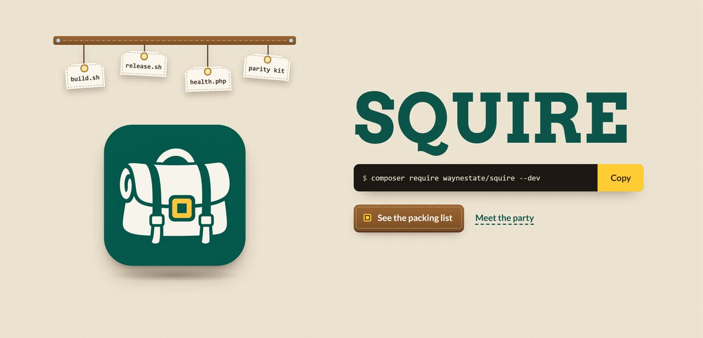
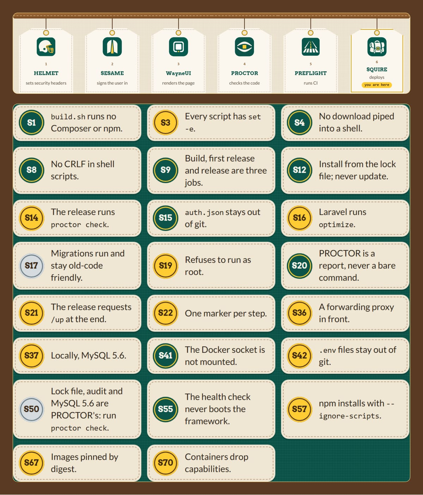
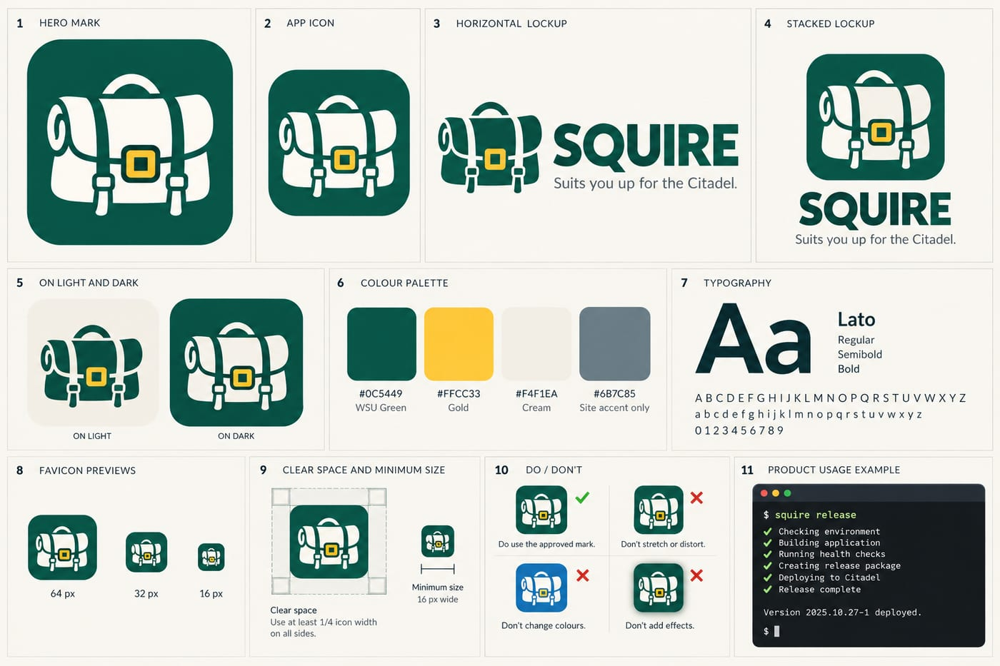

<div align="center">
  <a href="site/index.html"></a>
</div>

# Squire

<div align="center">
  
  
  
  <a href="https://github.com/waynestate/squire/actions/workflows/ci.yml"></a>
</div>

**Suits you up for deploy day.** A squire carries the kit, readies the armour and gets the knight on the field.

Checks: `composer ci` (the same command runs on GitLab and GitHub).

Squire is the Citadel kit: build.sh, the release script, the health check, and local parity on the real images. It is part of WELD, the Wayne State application stack, beside WayneUI (project 0, the interface layer), CREED, PROCTOR, Preflight, SESAME, HELMET, Pinstripe and Sourdough.

> A knight never suits up alone. Your app shouldn't deploy alone either.

Front page: [`site/index.html`](site/index.html), a static page you can serve from anywhere.
On Citadel it is served by the raw-PHP deploy layer in [`deploy/`](deploy/): a Squire kit whose front controller serves `site/` behind HELMET's security headers. For local development, keep serving `site/` directly.

Status: 0.2.1, tagged and on Packagist. This repository is published from Wayne State University's internal GitLab and mirrored to GitHub.

<details>
<summary>Open the bag: two more cuts of the front page</summary>

<div align="center">
  
</div>

</details>

<details>
<summary>The kit bag's label: the brand board</summary>

<div align="center">
  
</div>

</details>

## What it does

- `squire init` writes the scripts a Citadel app needs from templates, for raw PHP, Laravel or a static site, and detects
  a Vue/Inertia layer from `package.json`, adding the layer's release script and Node 22 parity service. `squire init
  --check` reports when your copies have drifted from the templates (depend, do not copy).
- `squire update` takes the new template versions for the files you never edited, and shows a diff for the ones you did.
  It never overwrites your edits, and it runs the same in CI and on a laptop.
- `squire doctor` checks an app against the best practices a machine can decide ([BEST_PRACTICES.md](BEST_PRACTICES.md)).
  The lock file, composer audit and MySQL 5.6 checks are owned by PROCTOR; `doctor` hands off to it (S50) instead of repeating them.
- A local setup that runs your app on the Citadel PHP image, behind a proxy like Citadel's, with the same MySQL 5.6.
- Squire's maintainers send platform improvement proposals to the platform team privately. Squire never touches a server.

## Install

```
composer require waynestate/squire --dev
vendor/bin/squire init
vendor/bin/squire doctor
```

PHP `^8.3`. Tested on 8.3, 8.4 and 8.5. The package runs on your machine or in CI, not on Citadel; what lands on Citadel
is the scripts it wrote.

## Commands

```
vendor/bin/squire init   [--path=.] [--target=auto|raw|laravel|static] [--only=release|parity] [--check] [--force]
vendor/bin/squire update [--path=.] [--target=raw|laravel|static] [--only=release|parity] [--dry-run]
vendor/bin/squire doctor [--path=.] [--format=text|json]
```

Exit codes: `0` pass, `1` findings (`init --check`: drift; `update`: an edited file still differs from the template;
`doctor`: a failed rule), `2` the tool itself could not run.

`init` never overwrites a file you edited, or a file it did not write, unless you pass `--force`. It records a SHA-256 of
each file in `.squire.json`; commit that file. `--only=release` writes just the Citadel scripts, `--only=parity` just the
local setup.

A Vue/Inertia app is a layer on `raw`, `laravel` or `static`, not a fourth target: `init` detects `vue` in `package.json`
(dependencies or devDependencies) and writes the layer's `.npmrc` and its `docker-compose.squire.yml` (with a Node 22 service) beside the target's files.
Every app, Vue or not, gets the one common `scripts/release.sh`, which installs the frontend from the lock file and runs
the `build` script whenever there is a `package.json`.

A raw PHP app (`--target=raw`, the default without an `artisan` file) gets a front controller, `public/index.php`, and an
`.htaccess` that sends every request to it. The front controller has three answers:

- a real file in `public/` (CSS, images, fonts, an HTML page) is served with its type, an ETag and an hour of cache,
  with HELMET's headers when HELMET is installed, and HELMET's CSP nonce on every `<script>` of an HTML page;
- a 404 for a dot file (`.htaccess`, `.git`), a NUL byte, a path that climbs out of `public/`, any `.php` or `.phar`
  other than the front controller, and any file that is not a site asset (a `.sql` dump, a `.bak`, a `.md` with no
  `.html` beside it);
- everything else goes to the app's entry: `app.php` beside `public/`, or the file `SQUIRE_APP_ENTRY` names (relative to
  the app directory, for example `src/bootstrap.php`). A `POST`, `PUT` or `DELETE` always goes to the entry.

The entry is the only PHP file the front controller runs, and it must sit inside the app directory and end in `.php`;
anything else is a plain 500 that names `SQUIRE_APP_ENTRY` and no path. The entry boots its own HELMET with its own
settings: the front controller boots HELMET (citadel preset) only for the answers it gives itself, never before the
entry, so HELMET is never booted twice. `public/up.php` answers on its own, because the `.htaccess` lets Apache run it
directly. The path checks and the MIME map are the static target's, and the tests keep the two in step.

An app that already has its own `public/index.php` or `public/.htaccess` keeps it: `init` reports the file as
`app-owned`, never records or overwrites it (not even with `--force`), and `init --check` does not count it as drift.
Delete your copy and run `init` to take Squire's. A front controller Squire wrote is tracked like any other file.

A static site is a target of its own: `--target=static` writes everything the `raw` target writes, with its own front
controller, `public/index.php`, and an `.htaccess` that routes every request that is not a real file to it. The site
itself is plain files you commit; the front controller serves them with HELMET's headers, injects the CSP nonce into the
HTML, and caches the assets. The site folder is `../../site` by default (the app lives in `deploy/` beside it); point
`SQUIRE_STATIC_ROOT` at a different folder. `public/up.php` still answers the health check, because a real file is served
straight by Apache and never reaches the front controller.

`update` reads that record: a file you never edited takes the new template, a file you edited is left alone and shown as a
diff, and a file Squire did not write is never touched. A squire polishes the armour; the knight keeps the sword.
`--dry-run` prints the plan and writes nothing.

## What lands in your app

| File | What it is |
|---|---|
| `build.sh` | Citadel's build hook: system packages only, POSIX sh, runs as root with no app source. No Composer, no npm. |
| `deployments/001-first-release.sh` | Runs once per app: calls the release script with the smoke test off (Apache is not up yet). |
| `scripts/release.sh` | The idempotent release: preconditions, `composer install --no-dev` from the lock file, audit, Laravel `migrate --force` and `optimize`, PROCTOR (a report by default, a gate with `SQUIRE_PROCTOR=enforce`), `/up` smoke test. Use it as the Quick Update post-script as well. |
| `health.php` | Citadel's health check (`["php","health.php"]`): one HTTP request to `/up`, never boots the framework. |
| `public/up.php` | Raw PHP and static: the endpoint that answers `ok`. Laravel has `/up` built in. |
| `public/index.php` | Raw: the front controller that serves `public/` files safely and hands the rest to the app's entry. Static: the one that serves the committed site with HELMET's headers. Never written over an app's own. |
| `public/.htaccess` | Raw: sends every request but `index.php` and `up.php` to the front controller. Static: routes every request that is not a real file to it. |
| `.npmrc` | Vue layer only: sets `min-release-age=1` for the frontend install. |
| Vue `docker-compose.squire.yml` | Vue layer only: the common parity compose plus a Node 22 service for frontend tooling. |
| `docker-compose.squire.yml`, `.squire/`, `.env.squire.example`, `scripts/parity.sh`, `scripts/parity.ps1` | Local parity. |

<div align="center">
  
  <br><sub>The packing list for deploy day: each tag lands on the strap and gets its stamp.</sub>
</div>

Every shell script uses `set -euo pipefail` (`build.sh` uses `set -eu`, because Citadel runs it with `/bin/sh`), prints a
`[squire] ==> step N: ...` marker for each step, and can be run twice with the same result.

## Copies of Squire's templates

Sourdough carries a generated copy of Squire's deploy templates instead of writing its own. The copy began when its
apps could not `composer require` Squire from an internal repository (no internal URLs may be committed). Squire is
on Packagist now (`0.2.1`), so the copy can become a real requirement; until Sourdough switches, the
copy stays. Squire owns the templates; the copy is checked in and verified, never hand-edited.

```
php bin/export-templates.php --to=templates/squire            # write the copy
php bin/export-templates.php --to=templates/squire --check    # verify it; exit 1 on drift
```

The copy holds, for each kind (`raw`, `laravel`, `static`) and for the Vue layer (`vue`), the files a new app gets from
`squire init`, at their target paths, with each file's mode recorded so executables stay executable. `catalog.json` lists
which files each kind and layer installs and where; `manifest.json` records the Squire version and a SHA-256 per file.
Refresh the copy when Squire's templates move on, and run `--check` in CI to keep it honest. A squire keeps the armour
polished; the copy stays in step.

## Citadel setup

1. In the dashboard set the build script to `build.sh`, the health check to `["php","health.php"]`, and the Quick Update
   post-script to `./scripts/release.sh` (user `citadel`).
2. Commit `composer.lock`, and `package-lock.json` or `pnpm-lock.yaml` if you have a frontend.
3. Mark the scripts executable in git. On Windows: `git update-index --chmod=+x build.sh scripts/*.sh deployments/*.sh`.
4. Set `SQUIRE_*` values in the dashboard environment (below), not in a file in the repository.

## Local parity

Needs Docker with Compose v2. Windows needs Docker Desktop with the WSL 2 backend; no shell other than PowerShell is
required.

```
# Linux and macOS
cp .env.squire.example .env.squire     # then set the passwords
scripts/parity.sh up                   # or: scripts/parity.sh up --fallback

# Windows (PowerShell 5.1 or 7)
Copy-Item .env.squire.example .env.squire
scripts\parity.ps1 up                  # or: scripts\parity.ps1 up -Fallback
```

Commands: `up`, `down`, `reset` (also removes volumes), `logs [service]`, `shell [service]`, `status`, `pin` (prints the
digests of the images you have pulled, so you can pin them).

It starts the app container from the Citadel image (built by Citadel's `build_images` command, or pulled from wherever you
keep it) with your source mounted at `/citadel/src`, runs your `deployments/` as the `citadel` user the way Citadel does,
and puts an HA-Proxy in front that adds the same forwarding headers. MySQL 5.6.51 is reachable from the app as host
`mysql` and from your machine on `127.0.0.1:3307`. Containers drop capabilities, set `no-new-privileges`, and carry memory
and process limits. The database port is bound to loopback only. The Vue layer's compose file adds a Node 22 service,
pinned to the same major as the Citadel image, for frontend tooling.

No access to the real image? `--fallback` builds an approximation from the official `php` image plus Citadel's extensions.
It is good for trying Squire out and not for proving parity. If the build step fails with a permission error writing
`vendor/`, the source folder is not writable by the container's `citadel` user (uid 1000 by default); on Linux set
`SQUIRE_SOURCE_UID` and `SQUIRE_SOURCE_GID` to yours.

## Configuration

All optional. On Citadel set them in the dashboard; locally, in `.env.squire`.

Release script (`scripts/release.sh`):

| Variable | Default | Meaning |
|---|---|---|
| `SQUIRE_APP_DIR` | parent of `scripts/` | App root. |
| `SQUIRE_FRAMEWORK` | `auto` | `auto`, `laravel` or `raw`. Laravel is detected from `artisan`. |
| `SQUIRE_ALLOW_ROOT` | `0` | `1` allows running as root. |
| `SQUIRE_REQUIRE_ENV` | `auto` | `1` requires a `.env` file; `auto` means Laravel does. |
| `SQUIRE_WRITABLE_DIRS` | Laravel: `storage`, `bootstrap/cache` | Directories to create. |
| `SQUIRE_COMPOSER_AUDIT` | `report` | `report`, `fail` or `skip`. |
| `SQUIRE_NPM` | `auto` | `auto` or `skip` (for committed built assets). |
| `SQUIRE_NPM_IGNORE_SCRIPTS` | `1` | Install with `--ignore-scripts`. |
| `SQUIRE_NPM_BUILD_SCRIPT` | `build` | The `package.json` script to run. |
| `SQUIRE_MIGRATE` | `1` | Laravel: `migrate --force`. |
| `SQUIRE_ARTISAN_OPTIMIZE` | `1` | Laravel: `optimize`. |
| `SQUIRE_PROCTOR` | `auto` | `auto`, `skip` or `enforce`. By default PROCTOR is a report and never stops the release; `enforce` makes a failed check stop it. |
| `SQUIRE_PROCTOR_BIN` | `vendor/bin/proctor`, then `PATH` | Where PROCTOR is. It is a dev dependency, so `--no-dev` removes it: point this at a copy. |
| `SQUIRE_PROCTOR_POLICY` | `vendor/waynestate/creed/policy/policy.json`, when installed | Path to the policy file. When unset, the script falls back to the policy the CREED package ships (the deploy wizard has no environment field); when CREED is not installed, PROCTOR runs on its own default policy with a notice. An explicit value always wins. |
| `SQUIRE_SMOKE` | `1` | Request the health URL at the end and fail unless it answers 200. |
| `SQUIRE_SMOKE_URL` | `http://127.0.0.1:80/up` (Laravel), `/up.php` (raw and static) | Full URL. |
| `SQUIRE_SMOKE_RETRIES` | `5` | Attempts. |
| `SQUIRE_SMOKE_DELAY` | `2` | Seconds between attempts. |

Front controller (raw `public/index.php`): `SQUIRE_APP_ENTRY` (`app.php`), the app's entry, relative to the app
directory. Static `public/index.php`: `SQUIRE_STATIC_ROOT` (`../../site`).

Health check (`health.php`): `SQUIRE_HEALTH_PATH`, `SQUIRE_HEALTH_PORT` (80), `SQUIRE_HEALTH_TIMEOUT` (5, at most 14, inside
Citadel's 15), `SQUIRE_HEALTH_VENDOR` (`1` also requires `vendor/autoload.php`).

Local parity (`.env.squire`): `SQUIRE_PROJECT`, `SQUIRE_BASE_IMAGE`, `SQUIRE_PROXY_IMAGE`, `SQUIRE_MYSQL_IMAGE`,
`SQUIRE_PUBLIC_DIR`, `SQUIRE_SERVER_NAME`, `SQUIRE_TZ`, `SQUIRE_ENVIRONMENT`, `SQUIRE_DEPLOYMENTS`, `SQUIRE_HTTP_PORT`,
`SQUIRE_APP_MEMORY`, `SQUIRE_SOURCE_UID`, `SQUIRE_SOURCE_GID`, `SQUIRE_DB_NAME`, `SQUIRE_DB_USER`, `SQUIRE_DB_PASSWORD`,
`SQUIRE_DB_ROOT_PASSWORD`, `SQUIRE_DB_PORT`, `SQUIRE_DB_MEMORY`. The Vue layer's compose file also reads
`SQUIRE_NODE_IMAGE` (default `node:22-bookworm-slim`), `SQUIRE_NODE_ENV` (default `production`) and `SQUIRE_NODE_MEMORY`
(default `512m`). The compose file refuses to start without the two passwords. See `.env.squire.example`; it holds
placeholders only.

## Development

Maintainers: how to build, test and release this project, and where its data comes from, is in [MAINTAINING.md](MAINTAINING.md).

```
composer install
composer ci          # validate, phpunit, pint, phpstan, audit
```

PHPStan and Pint follow Pinstripe, the stack's coding standard: `phpstan.neon` includes Pinstripe's raw PHP preset
(`vendor/waynestate/pinstripe/phpstan/raw.neon`) and keeps only Squire's own paths and PHP version range, and Pint runs
the same built-in `per` preset that Pinstripe's `pint/per.json` wraps, so `pint.json` stays local with Squire's own
excludes.

Run it in Docker the same way CI does:

```
docker run --rm -v "$PWD:/app" -w /app composer:2.10.3 sh -c "composer install --no-interaction && composer ci"
```

The shell templates are linted with shellcheck in Docker (`scripts/lint-shell.sh`, or `scripts/lint-shell.ps1` on
Windows) and the PowerShell with PSScriptAnalyzer (`scripts/lint-powershell.ps1`). The tests run the real shell templates
against stub `composer`, `curl`, `npm`, `corepack` and `proctor` programs, and start a PHP server to test `health.php`.

## Known limits in 0.2

See [OPEN_QUESTIONS.md](OPEN_QUESTIONS.md). The big ones: the local `php.ini` holds safe defaults rather than the
platform's file, the Citadel image has no digest to pin, and a full Update may not refresh `vendor/`. PROCTOR can now
gate a release with `SQUIRE_PROCTOR=enforce`; what is still missing on its side is a phar and a dedicated `gate` command.

## Licence

MIT, copyright Wayne State University. A squire carries the armour; the knight still has to show up.

<div align="center">

## The rest of the party

  <a href="https://github.com/waynestate/wayne-ui"></a>
  <a href="https://github.com/waynestate/creed"></a>
  <a href="https://github.com/waynestate/proctor"></a>
  <a href="https://github.com/waynestate/sesame"></a>
  <a href="https://github.com/waynestate/helmet"></a>
  <a href="https://github.com/waynestate/sourdough"></a>
  <a href="https://github.com/waynestate/squire"></a>
  <a href="https://github.com/waynestate/preflight"></a>
  <a href="https://github.com/waynestate/pinstripe"></a>
  <a href="https://github.com/waynestate/booster"></a>
  <a href="https://github.com/waynestate/rollcall"></a>
  <a href="https://github.com/waynestate/drawbridge"></a>
  <a href="https://github.com/waynestate/advisor"></a>
  <a href="https://github.com/waynestate/weld"></a>

<sub>A squire is only as good as the party it rides with. Mind the buckle.</sub>

</div>
