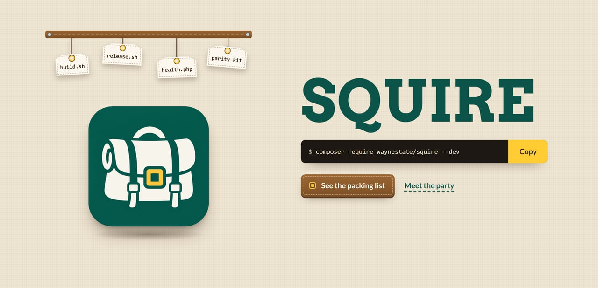
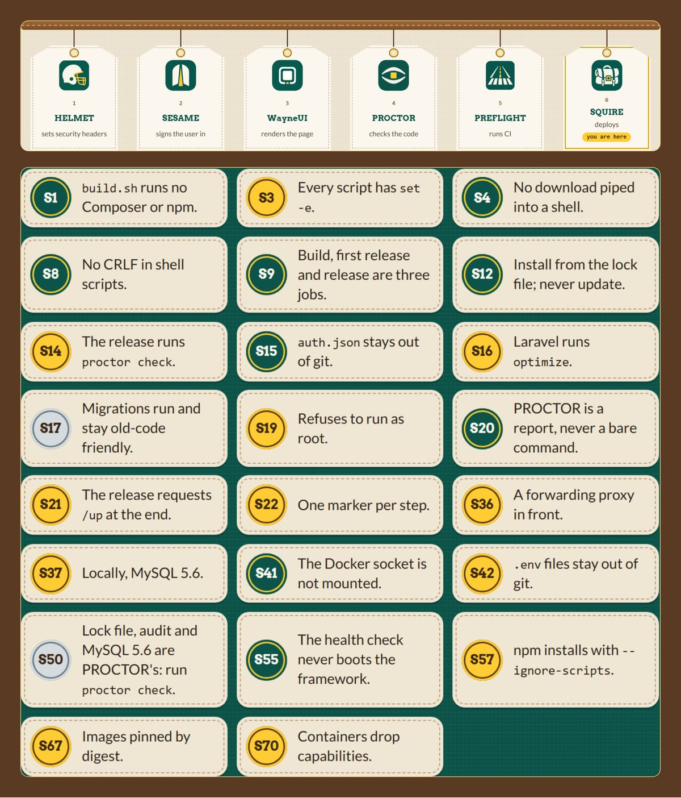
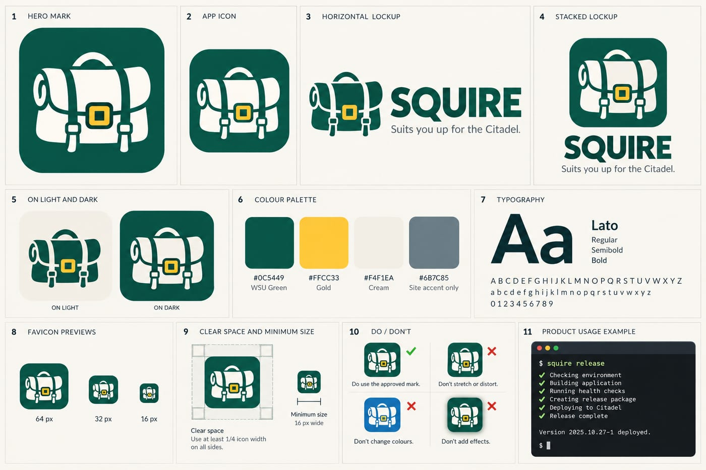

<div align="center">
  <a href="site/index.html"></a>
</div>

# Squire

<div align="center">
  
  
  
  <a href="https://github.com/waynestate/squire/actions/workflows/ci.yml"></a>
</div>

**Suits you up for deploy day.** A squire carries the kit, readies the armor and gets the knight on the field.

Documentation: [squire.apps.wayne.edu/docs/](https://squire.apps.wayne.edu/docs/)

Checks: `composer ci` (the same command runs on GitLab and GitHub).

Squire is the Citadel kit: build.sh, the release script, the health check, and local parity on the real images. Its docs builder turns `docs/` into the committed pages under `site/docs/`, with a changelog page generated from `CHANGELOG.md` when the nav lists one. It is part of WELD, the Wayne State application stack, beside WayneUI (project 0, the interface layer), CREED, PROCTOR, Preflight, SESAME, HELMET, Pinstripe and Sourdough.

**Not to be confused with:** `squire doctor` checks deploy setup only; standards checks are PROCTOR's.

> A knight never suits up alone. Your app shouldn't deploy alone either.

Front page: [`site/index.html`](site/index.html), a static page you can serve from anywhere.
On Citadel it is served by the raw-PHP deploy layer in [`deploy/`](deploy/): a Squire kit whose front controller serves `site/` behind HELMET's security headers. For local development, keep serving `site/` directly.

Status: 0.5.0, tagged and on Packagist.

## Where the code lives

The canonical repository is [git.wayne.edu/enterprise-apps/squire](https://git.wayne.edu/enterprise-apps/squire); clone it over SSH as `git@git.wayne.edu:enterprise-apps/squire.git` or over HTTPS as `https://git.wayne.edu/enterprise-apps/squire.git`. Open issues and merge requests there; tags are cut there, by a maintainer, with an approver.
GitHub ([waynestate/squire](https://github.com/waynestate/squire)) is a read-only push mirror of it: Packagist reads from it, and nobody pushes to it.
Your squire serves one banner, and it flies over git.wayne.edu.

<details>
<summary>Open the bag: two more cuts of the front page</summary>

<div align="center">
  
</div>

</details>

<details>
<summary>The kit bag's label: the brand board</summary>

<div align="center">
  
</div>

</details>

## Docs

The pages under `docs/` build into the committed site at `site/docs/`: rebuild with `composer docs`, check with `composer docs:check`.

## What it does

- `squire init` writes the scripts a Citadel app needs from templates, for raw PHP, Laravel or a static site, and detects
  a Vue/Inertia layer from `package.json`, adding the layer's release script and Node 22 parity service. `squire init
  --check` reports when your copies have drifted from the templates (depend, do not copy). In a directory below the
  repository root (a `deploy/` layer, say), `init` also keeps the `.gitignore` honest: it appends `/vendor/`, `.env` and
  `.env.squire` when they are missing, never touches a line the app added, and leaves the repository root's `.gitignore`
  to the app.
- `squire update` takes the new template versions for the files you never edited, writes the template files a newer
  release added to a group the kit records (recording them in `.squire.json`), and shows a diff for the ones you did.
  It never overwrites your edits, and it runs the same in CI and on a laptop.
- `squire doctor` checks an app against the best practices a machine can decide ([BEST_PRACTICES.md](BEST_PRACTICES.md)).
  The lock file, composer audit and MySQL 5.6 checks are owned by PROCTOR; `doctor` hands off to it (S50) instead of repeating them.
- A local setup that runs your app on the Citadel PHP image, behind a proxy like Citadel's, with the same MySQL 5.6.
- Squire's maintainers send platform improvement proposals to the platform team privately. Squire never touches a server.

## Install

```
composer require waynestate/squire --dev
vendor/bin/squire init
vendor/bin/squire doctor
```

PHP `^8.3`. Tested on 8.3, 8.4 and 8.5. The package runs on your machine or in CI, not on Citadel; what lands on Citadel
is the scripts it wrote.

## Commands

```
vendor/bin/squire init   [--path=.] [--target=auto|raw|laravel|static] [--only=release|parity] [--check] [--force]
vendor/bin/squire update [--path=.] [--target=raw|laravel|static] [--only=release|parity] [--dry-run]
vendor/bin/squire doctor [--path=.] [--format=text|json]
```

Exit codes: `0` pass, `1` findings (`init --check`: drift; `update`: an edited file still differs from the template;
`doctor`: a failed rule), `2` the tool itself could not run.

`vendor/bin/squire doctor oracle` runs the same plain-language Oracle connection check that `release.sh` runs on
Citadel, from your terminal or `sail php vendor/bin/squire doctor oracle`. It reads the `ORACLE_*` settings from the
environment and the app's `.env`, prints setting names and never values, and stays silent when the app has no Oracle
settings. Add `-v` for the client version.

`init` never overwrites a file you edited, or a file it did not write, unless you pass `--force`. It records a SHA-256 of
each file in `.squire.json`; commit that file. `--only=release` writes just the Citadel scripts, `--only=parity` just the
local setup.
The release installs from the lock file, so when the app has no `composer.json` or no `composer.lock`, `init` ends with a "Heads up" line: commit both before the first deploy (`composer init`, then `composer update`), or the release stops at step 1.

A Vue/Inertia app is a layer on `raw`, `laravel` or `static`, not a fourth target: `init` detects `vue` in `package.json`
(dependencies or devDependencies) and writes the layer's `.npmrc` and its `docker-compose.squire.yml` (with a Node 22 service) beside the target's files.
Every app, Vue or not, gets the one common `scripts/release.sh`, which installs the frontend from the lock file and runs
the `build` script whenever there is a `package.json`.

A raw PHP app (`--target=raw`, the default without an `artisan` file) gets a front controller, `public/index.php`, and an
`.htaccess` that sends every request to it. The front controller has three answers:

- a real file in `public/` (CSS, images, fonts, an HTML page) is served with its type, an ETag and an hour of cache,
  with HELMET's headers when HELMET is installed, and HELMET's CSP nonce on every `<script>` of an HTML page;
- a 404 for a dot file (`.htaccess`, `.git`), a NUL byte, a path that climbs out of `public/`, any `.php` or `.phar`
  other than the front controller, and any file that is not a site asset (a `.sql` dump, a `.bak`, a `.md` with no
  `.html` beside it);
- everything else goes to the app's entry: `app.php` beside `public/`, or the file `SQUIRE_APP_ENTRY` names (relative to
  the app directory, for example `src/bootstrap.php`). A `POST`, `PUT` or `DELETE` always goes to the entry.

The entry is the only PHP file the front controller runs, and it must sit inside the app directory and end in `.php`;
anything else is a plain 500 that names `SQUIRE_APP_ENTRY` and no path. The entry boots its own HELMET with its own
settings: the front controller boots HELMET (citadel preset) only for the answers it gives itself, never before the
entry, so HELMET is never booted twice. `public/up.php` answers on its own, because the `.htaccess` lets Apache run it
directly. The path checks and the MIME map are the static target's, and the tests keep the two in step.

An app that already has its own `public/index.php` or `public/.htaccess` keeps it: `init` reports the file as
`app-owned`, never records or overwrites it (not even with `--force`), and `init --check` does not count it as drift.
Delete your copy and run `init` to take Squire's. A front controller Squire wrote is tracked like any other file.

A static site is a target of its own: `--target=static` writes everything the `raw` target writes, with its own front
controller, `public/index.php`, and an `.htaccess` that routes every request that is not a real file to it. The site
itself is plain files you commit; the front controller serves them with HELMET's headers, injects the CSP nonce into the
HTML, and caches the assets. The site folder is `../../site` by default (the app lives in `deploy/` beside it); point
`SQUIRE_STATIC_ROOT` at a different folder. `public/up.php` still answers the health check, because a real file is served
straight by Apache and never reaches the front controller.

`update` reads that record: a file you never edited takes the new template, a file you edited is left alone and shown as a
diff, a file a newer release added to a recorded group is written and recorded, and a file Squire did not write is never
touched. A squire polishes the armor; the knight keeps the sword.
`--dry-run` prints the plan and writes nothing.

## What lands in your app

| File | What it is |
|---|---|
| `build.sh` | Citadel's build hook: system packages only, POSIX sh, runs as root with no app source. No Composer, no npm. |
| `deployments/001-first-release.sh` | Runs once per app: calls the release script with the smoke test off (Apache is not up yet). |
| `scripts/release.sh` | The idempotent release: preconditions, `composer install --no-dev` from the lock file, audit, PROCTOR's deploy gate (`proctor gate`, a report by default, a stop with `SQUIRE_PROCTOR=enforce`), frontend build, Laravel `migrate --force` and `optimize`, an Oracle connection check (a report, never a gate), `/up` smoke test. Use it as the Quick Update post-script as well. |
| `health.php` | Citadel's health check (`["php","health.php"]`): one HTTP request to `/up`, never boots the framework. |
| `oracle-check.php` | The plain-language Oracle connection check the release runs: settings, host, port, driver, login. A report, never a gate; silent when the app has no `ORACLE_*` settings. |
| `public/up.php` | Raw PHP and static: the endpoint that answers `ok`. Laravel has `/up` built in. |
| `public/index.php` | Raw: the front controller that serves `public/` files safely and hands the rest to the app's entry. Static: the one that serves the committed site with HELMET's headers. Never written over an app's own. |
| `public/.htaccess` | Raw: sends every request but `index.php` and `up.php` to the front controller. Static: routes every request that is not a real file to it. |
| `.npmrc` | Vue layer only: sets `min-release-age=1` for the frontend install. |
| Vue `docker-compose.squire.yml` | Vue layer only: the common parity compose plus a Node 22 service for frontend tooling. |
| `docker-compose.squire.yml`, `.squire/`, `.env.squire.example`, `scripts/parity.sh`, `scripts/parity.ps1` | Local parity. |

<div align="center">
  
  <br><sub>The packing list for deploy day: each tag lands on the strap and gets its stamp.</sub>
</div>

Every shell script uses `set -euo pipefail` (`build.sh` uses `set -eu`, because Citadel runs it with `/bin/sh`), prints a
`[squire] ==> step N: ...` marker for each step, and can be run twice with the same result.

The release also runs an Oracle connection check (`oracle-check.php`) after the migrations and before the smoke test. It is a
report, never a gate: a finding prints in the deployment log and the release goes on. When the app does not use Oracle
(no `ORACLE_*` settings) it prints nothing. It checks, in order, that the settings are present, that the host resolves,
that the port answers within 3 seconds, that the `oci8` driver is loaded, and that the login works, stopping at the first
failure so a bad port never costs a login attempt. Settings: `ORACLE_USERNAME`, `ORACLE_PASSWORD`, and either `ORACLE_TNS`
(Easy Connect `host:port/service`, or a full `(DESCRIPTION=...)` descriptor) or `ORACLE_HOST`, `ORACLE_PORT` and
`ORACLE_SERVICE_NAME`. Only setting names are ever printed, never values.

## Copies of Squire's templates

Sourdough carries a generated copy of Squire's deploy templates instead of writing its own. The copy began when its
apps could not `composer require` Squire from an internal repository (no internal URLs may be committed). Squire is
on Packagist now, and Sourdough requires it as a dev dependency and regenerates its copy from the package. Squire owns the templates; the copy is checked in and verified, never hand-edited.

```
php bin/export-templates.php --to=templates/squire            # write the copy
php bin/export-templates.php --to=templates/squire --check    # verify it; exit 1 on drift
```

The copy holds, for each kind (`raw`, `laravel`, `static`) and for the Vue layer (`vue`), the files a new app gets from
`squire init`, at their target paths, with each file's mode recorded so executables stay executable. `catalog.json` lists
which files each kind and layer installs and where; `manifest.json` records the Squire version and a SHA-256 per file.
Refresh the copy when Squire's templates move on, and run `--check` in CI to keep it honest. A squire keeps the armor
polished; the copy stays in step.

## The agent-ready kit

Every stack repo carries the same bytes: a Markdown twin beside every page in the site folder, plus `llms.txt`,
`llms-full.txt`, `robots.txt` and `sitemap.xml`, styled by the kit's `agent-ready.css` and `agent-ready.js` in the
site's `assets/` folder. Squire owns the kit, and a site takes a new version from a Squire checkout with
`php bin/agent-ready.php --sync-to=<repo>`, which copies the kit and the tool itself. The site then regenerates its
files with `php bin/agent-ready.php` and commits them, and runs `--check` in CI to stay honest.

A library package that carries the kit should keep it out of Composer downloads: add to its `.gitattributes`

```
/bin/agent-ready.php export-ignore
/site export-ignore
```

so a `composer require` of the package never ships the kit. A squire packs what the knight will carry, and only that.

## The docs builder

`bin/docs-site.php` turns the Markdown under `docs/` into committed, accessible HTML pages under `site/docs/`: one page
per file, in the order of `docs/nav.json`, with a sidebar, an "On this page" list, prev and next links, and the version
stamped from the top of `CHANGELOG.md`. The optional `source` and `mirrors` keys in `docs/nav.json` render a Source link
in the header and footer, with the mirrors beside it, so the canonical repo home is one config value, never a hard-coded
URL. Pages are styled by WayneUI plus the kit's `docs.css` and `docs.js` in the site's
`assets/` folder, so every stack repo reads the same way. `docs.js` adds a copy button to every code block (it says
Copied or Copy failed, and tells screen readers too) and puts a block that scrolls sideways in the tab order, so a
keyboard can reach it (a block inside a code tab is measured again when its tab shows). Squire owns the kit, and a repo takes a new version from a
Squire checkout with `php bin/docs-site.php --sync-to=<repo>`, which copies the kit and the tool itself. The repo then
builds with `php bin/docs-site.php` (or `composer docs`) and commits `site/docs/`, and runs `--check` (or
`composer docs:check`) in CI to fail when a page is stale or a finding is present. A squire keeps the map current, so the
knight never asks for directions twice.

### Generated blocks

A page may hold a region the builder owns, marked in the Markdown source:

```
<!-- generated:commands -->
...whatever the builder wrote last time...
<!-- /generated -->
```

`docs/docs.json` defines the blocks by name. Each block rewrites its region from the repo's own state: `json-table` and
`symfony-commands` run a command from the repo root (a leading `php ` means the PHP binary, so the same file works on
Windows, macOS and Linux) and render the command's JSON output, and `env` scans the source files for the environment
variables the code reads.

The `json-table` type runs its `run` command, takes the list at its `path` key from the JSON output, and renders a
Markdown table: each column is `[heading, key]` or `[heading, key, "code"]` for a code span, a missing key gives an
empty cell, booleans print `yes` or `no`, lists print comma separated, Symfony console style tags are stripped so a
help cell reads plain, and pipes in a cell are escaped.

```json
{
    "blocks": {
        "hops": {
            "type": "json-table",
            "run": "php bin/booster hops --format=json",
            "path": "hops",
            "columns": [["Hop", "id", "code"], ["What it does", "summary"]]
        }
    }
}
```

The `symfony-commands` type runs `<run> list --format=json` and renders the command reference: an overview table of
command and description, then per command a heading at `level` (default 3), its description, one `Usage:` line per
usage string, an Arguments table when it has arguments, and an Options table when it has options. An option prints its
shortcut first (`-p`, `--path=VALUE`) and gets `=VALUE` only when it takes a value; its default prints in a code span,
or stays empty when it is false. The built-in commands (`help`, `list`, `completion`, `_complete`) and hidden commands
are skipped, and the application-level options (`--help`, `--quiet`, `--verbose`, `--version`, `--ansi`, `--no-ansi`,
`--no-interaction`) are listed once, under "Options every command accepts".

```json
{
    "blocks": {
        "commands": {
            "type": "symfony-commands",
            "run": "php bin/console",
            "cli": "bin/console",
            "level": 3
        }
    }
}
```

The `env` type walks the `scan` folders for quoted environment variable names that start with `prefix`, skips the
names in `ignore` (an exact name, or a trailing `*` for a prefix), and renders one row per variable, sorted by name:
its meaning and default from `describe` (a `[meaning, default]` pair) and the first file that reads it. A variable the
code reads that `describe` does not list, and a variable `describe` lists that no scanned file reads, are findings.

```json
{
    "blocks": {
        "environment": {
            "type": "env",
            "scan": ["src", "config"],
            "prefix": "APP_",
            "ignore": ["APP_KEY"],
            "describe": {
                "APP_NAME": ["The app name", "Demo"],
                "APP_ENV": ["The environment", "production"]
            }
        }
    }
}
```

A plain run rewrites stale regions in the sources and then builds; `--check` reports a stale region instead of writing.
A region whose name is not in `docs.json`, a block no page places, a block placed twice, and an opening marker with no
closing marker are findings.

### Changelog page

When `docs/nav.json` lists a page whose path is `changelog`, the builder owns `docs/changelog.md`: a plain run writes
it from the repo's `CHANGELOG.md` before building, and `--check` never writes. The page takes the usual front matter
(`title: "Changelog"` and a description), a marker comment naming its source, and the changelog's body with its
top-level heading dropped, so every version heading stays as written: `## Unreleased`, `## [Unreleased]`,
`## 0.5.0 (2026-11-03)` and `## [0.1.9] - 2026-11-03` all keep their shape and get the page's usual anchors. Links
follow the site's rules: an `http(s)` link stays, a relative link becomes a blob link under the nav.json `source`
(`https://repo.example.com/acme/app/-/blob/main/README.md`) when there is one, and loses its link, keeping its label,
when there is not. A nav entry without a `CHANGELOG.md` is a finding, and a changed `CHANGELOG.md` or a missing
`docs/changelog.md` is drift.

### Callouts

A blockquote whose first line is a marker alone becomes a callout instead of a quotation:

```
> [!NOTE]
> The body keeps the note.
```

The marker is case-insensitive and one of `[!NOTE]`, `[!TIP]`, `[!WARNING]` or `[!DANGER]`. The builder renders an
`<aside>` with the classes `docs-callout` and `docs-callout--note` (one per kind), `role="note"`, a visible label,
and the body below it, and drops the marker line from the body. A blockquote without a marker, or with a marker that
is not one of the four, stays a plain blockquote. The kit's `docs.css` styles all four kinds from WayneUI tokens, in
light and dark themes.

### Code tabs

Consecutive fenced code blocks whose info string carries tab="LABEL" (double quotes, label up to 40 characters) render as
one labeled tab set instead of separate code blocks:

````
```bash tab="composer"
composer install
```

```bash tab="sail"
./vendor/bin/sail up
```
````

The word before tab="..." stays the language, so the first panel keeps its `language-bash` class. The builder wraps the
run in a `docs-tabs` element keyed by the lowercased labels joined by `|` (`data-tabs="composer|sail"`), and gives each
panel a `docs-tabs__panel` element carrying its label and the code escaped exactly like a plain fenced block, so every
example reads without JavaScript. A lone tab="..." block renders as a plain code block with the tab="..." word dropped
from its language class, and a run broken by anything else becomes separate sets. The kit's `docs.js` turns each set into
an accessible tablist (click, arrow keys, Home and End), remembers the chosen label per key in `localStorage`, and keeps
every set sharing a key in step; `docs.css` styles the tabs from WayneUI tokens, and print shows every panel.

### Task lists

A GitHub task list item (`- [ ] Protect the default branch`) renders a disabled checkbox. The builder wraps the checkbox
and the item's own text in a `<label class="docs-task">`, so the checkbox is named by what it checks; a nested list or a
second paragraph stays outside the label.

### Theme

An optional `theme` key in `docs/docs.json` wears the site's own brand on the pages, without touching the kit:

```json
{
    "theme": {
        "css": "docs-theme.css",
        "header": "_header.html"
    }
}
```

Both members are optional and independent, and both are plain relative paths against `docs/`: no leading slash, no
drive letter, no `..` segment, no backslash. A non-object `theme`, a non-string member, an unknown key, an empty string
or a path that does not exist is a tool error naming the key.

`css` names a stylesheet the builder copies byte for byte to `site/docs/theme/<basename>` and links after `docs.css` on
every page, so its rules win. It is a builder-owned file like a copied image: `--check` compares it, reports it stale
when it differs, and flags a copy under `site/docs/theme/` as a leftover once the key goes away. The builder never reads
the CSS: colors, fonts and every `--dk-*` override live there, and its `url()` values are written relative to
`site/docs/theme/`. Dark mode lives in the theme CSS too (`prefers-color-scheme` and a `data-theme` override), not in
the builder.

`header` names an HTML fragment with exactly one `<header>...</header>` element. It replaces the generic docs header in
place, after the skip link; the skip link, the mobile menu, the sidebar, the pager and the footer stay. The fragment may
not carry a `<script>`, an `id="main"`, a `wsu-skip-link`, a `docs-menu` or a `<main>`: those belong to the builder.
Relative `href`, `src` and `srcset` URLs in the partial are written against `site/` (the way the front page writes
them), and the builder prefixes each with the page depth; `#`, `/`, `//` and scheme URLs stay put. On every page the
first link to `docs/index.html` or `docs/` gets `aria-current="page"`, unless it already carries an `aria-current`. The
placeholders `{{project}}` (the HTML-escaped project name) and `{{version}}` (the docs stamp) are filled; any other
`{{...}}` fails the build, naming it. With no `theme` key, or an empty one, every generated byte matches the unthemed
build.

A small, realistic partial:

```html
<header class="brand-header">
  <a class="brand-mark" href="index.html#top"></a>
  <span class="brand-name">{{project}}</span>
  <nav aria-label="Site">
    <a href="index.html#start">Start</a>
    <a href="docs/index.html">Docs</a>
  </nav>
</header>
```

Squire's own docs wear this hook: `docs/_header.html` is the front page's masthead (the satchel, SQUIRE, the same
links and the version tag) and `docs/theme/squire.css` carries the front page's canvas, leather, Arvo titles, luggage
tags and terminals, with a derived dark set. To change how Squire's docs look, edit those two files and rebuild; never
edit the kit.

### Dark mode

The kit's `docs.css` holds every color behind a `--dk-*` alias as `var(--wsu-token, fallback)`, and the fallbacks follow
WayneUI's own resolution order: an explicit choice first (`data-theme="dark"` or `data-theme="light"` on the root
element, which WayneUI writes from the reader's saved preference), then the reader's system setting through a
`prefers-color-scheme: dark` query scoped to `:root:not([data-theme="light"])`, else light. The light `:root` block stays
the default; `:root[data-theme="dark"]` and the media-query block carry the dark fallbacks, and each declares
`color-scheme` so form controls and scrollbars follow the theme. With WayneUI loaded its tokens resolve instead and it
switches them itself, so the hex fallbacks only apply when WayneUI is absent. Every text pair (ink, muted, links,
callout labels, code, and the accent's on-color) meets WCAG AA contrast in both themes, and nothing outside the three
alias blocks carries a hard-coded color.

### What the check proves

- For a `symfony-commands` block, a code span or fenced line that starts with the CLI name must name a real command
  (`help` and `list` always pass), and every `--option` on it must be an option of that command or an application
  option; an unknown command or option is a finding.
- Every command and every option the CLI keeps must appear in the docs at least once (the generated block counts);
  a command or option nobody documented is a finding.
- A fenced block whose info string contains `docs-test: skip` is not scanned, and plain prose is never scanned.
- Every link a person wrote in the docs reaches something the site serves: a built page, a file under `site/`, or an
  external address; a relative link to a file the site does not serve (for example `../README.md`) is a finding.
- A fragment in a link must name a real heading on the page it points at, whether that is the page itself (`#setup`)
  or another built page (`guides/start.html#setup`); a missing id is a finding.
- Every image a page references (a Markdown image or an HTML ``) must name a file under `docs/`, resolved against
  the source page's folder, and the build copies it byte for byte to the same relative path under `site/docs/` so the
  built page's relative src still resolves; a missing image is a finding, and unreferenced files are never copied.
- Every page carries the version stamp as a `docs-version` meta tag and in the footer, so a reader sees which release
  the docs describe.
- A `composer.json` with a `version` field must agree with the stamp; a different version is a finding.
- `--require-release` fails when `CHANGELOG.md` has no released heading yet, because the stamp would be `unreleased`.
- `--require-tag` fails when the repo's latest version tag does not match the stamp (a tag such as `v1.6.0` counts as
  `1.6.0`); the flag is off by default, so an untagged repo builds clean.
- When the nav lists a `changelog` page, `docs/changelog.md` mirrors `CHANGELOG.md` (front matter, marker comment, no
  top-level heading); a changed `CHANGELOG.md` or a missing page is drift, and a nav entry without a `CHANGELOG.md` is
  a finding.

### Tested examples

`php bin/docs-site.php --examples` runs the tagged command examples in the docs and fails when reality drifts from
what they promise. A fenced block whose info string is `bash run`, `sh run`, `console run` or `shell run`
(optionally `exit=N`, default 0) is a command block: each non-empty line is a command (a leading `$ ` is stripped),
run in order in a fresh temp copy of the `examples.cwd` folder; the next fenced block, when its info string is exactly
`output`, is the expected output (stdout then stderr). Both sides are normalized before the comparison: CRLF to LF,
trailing spaces trimmed per line, trailing blank lines removed, the example working directory and the repo root
rewritten to the placeholders below, plus every regex rule in `examples.normalize`:

```
<cwd>
<root>
```

Every shell block (bash, sh, shell, console, powershell or pwsh) must be tagged `run` or carry an HTML comment line
reading `docs-test: skip REASON` directly before it; a block with neither, and a marker without a reason, are
findings naming the file and line. Skips are counted and grouped by the words before the first comma, case-folded, in
the one-line summary (`Examples: 7 run, 12 skipped (reasons: needs network 5, needs Docker 4)`), and `examples.maxSkips`
in `docs/docs.json` caps them. The other keys of `examples` are optional: `cwd` names the repo folder copied into each
example working directory, `alias` replaces a matching first word with another command (a leading `php ` means the
PHP binary, a relative script path resolves against the repo root), `env` adds environment variables, and `timeout`
caps each command in seconds (default 60). Generated-block regions are ignored, and a plain build and `--check`
never run examples.

### JavaScript tests

The kit's `docs.js` carries its own tests in `tests/js/` (node:test with jsdom, pinned exactly in `package.json` and
`package-lock.json`), and they run the same way locally and in CI. With Node 22 on the PATH:

```
npm ci && npm test
```

or, with only Docker:

```
docker run --rm -v "$PWD:/app" -w /app node:22-alpine sh -c "npm ci && npm test"
```

The `js-tests` job runs the same two commands on GitLab and GitHub. It stays out of `composer ci` because the PHP
image has no Node.

## Use Squire from your coding agent (ADVISOR)

Squire ships an [ADVISOR](https://github.com/waynestate/advisor) module, so a coding agent that runs ADVISOR can run
Squire's checks without leaving its sandbox. In the app, install ADVISOR as a dev dependency (`composer require
--dev waynestate/advisor`) and add one line to the app's `modules.json` (or point `ADVISOR_MODULES_FILE` at a file
that holds it):

```json
{
    "modules": [
        "Waynestate\\Squire\\Advisor\\SquireModule"
    ]
}
```

Two tools appear. Both are read-only, and each takes exactly one argument: a path inside the project root.

- `squire_doctor` runs Squire's deploy-setup checks (the S-rules, S1 to S78) against the app folder and returns the
  same JSON report `vendor/bin/squire doctor --format=json` prints. It runs in-process: no subprocess, no network,
  nothing written.
- `squire_drift` reports which of the files Squire wrote into the app have drifted from the current templates, the
  same check `vendor/bin/squire init --check` performs: missing, outdated, edited or untracked, per file. It writes
  nothing; `squire init` is the fix, and it never overwrites an edit.

Every answer labels its source and says plainly what ran. Squire reports; Squire in CI decides pass or fail. A squire
can tell you where the armor is dented; only the knight gets to charge.

## Citadel setup

1. In the dashboard set the build script to `build.sh`, the health check to `["php","health.php"]`, and the Quick Update
   post-script to `./scripts/release.sh` (user `citadel`).
2. Commit `composer.lock`, and `package-lock.json` or `pnpm-lock.yaml` if you have a frontend.
3. Mark the scripts executable in git. On Windows: `git update-index --chmod=+x build.sh scripts/*.sh deployments/*.sh`.
4. Set `SQUIRE_*` values in the app's `./.env` configuration file (below), not in a file in the repository. The
   dashboard has no environment field; its configuration-files step, after the wizard, writes `./.env` into the
   source tree. A Laravel app reads `./.env` already; a raw PHP app loads it with `vlucas/phpdotenv`
   (`Dotenv\Dotenv::createUnsafeImmutable($root)->safeLoad()`), so `getenv()` sees the values and a real environment
   variable wins.

## Local parity

Needs Docker with Compose v2. Windows needs Docker Desktop with the WSL 2 backend; no shell other than PowerShell is
required.

**On Windows, keep the source in the WSL 2 filesystem.** Advice, not a requirement: keep the app's source tree inside
the WSL 2 Linux filesystem (for example under `~/src` in your WSL distribution) and run `scripts/parity.sh` from there,
not from a Windows folder such as `C:\Users\you\...` reached through `/mnt/c`. Bind mounts from the Windows side are much
slower (Composer and npm installs feel it most), and file ownership and permissions do not map cleanly; that is the cause
of the `Permission denied` failure described under the bind-mount question (OPEN_QUESTIONS 15). The PowerShell
`scripts\parity.ps1` still works from a Windows folder, only slower.

### Engines and licenses

Squire needs any engine that runs Docker Compose v2 compatible files. The ones named here:

- **Docker Engine on Linux**: open source, Apache 2.0.
- **Docker Desktop on Windows** with the WSL 2 backend: a commercial product, free for small business, personal and
  educational use, and paid for larger organizations, so check your own license.
- **Podman** with a Compose v2 compatible provider, and **Colima** on macOS: expected to work, not tested here.

Only Docker Desktop and Docker Engine have been run.

```
# Linux and macOS
cp .env.squire.example .env.squire     # then set the passwords
scripts/parity.sh up                   # or: scripts/parity.sh up --fallback

# Windows (PowerShell 5.1 or 7)
Copy-Item .env.squire.example .env.squire
scripts\parity.ps1 up                  # or: scripts\parity.ps1 up -Fallback
```

Commands: `up`, `down`, `reset` (also removes volumes), `logs [service]`, `shell [service]`, `status`, `pin` (prints the
digests of the images you have pulled, so you can pin them).

It starts the app container from the Citadel image (built by Citadel's `build_images` command, or pulled from wherever you
keep it) with your source mounted at `/citadel/src`, runs your `deployments/` as the `citadel` user the way Citadel does,
and puts an HA-Proxy in front that adds the same forwarding headers. MySQL 5.6.51 is reachable from the app as host
`mysql` and from your machine on `127.0.0.1:3307`. Containers drop capabilities, set `no-new-privileges`, and carry memory
and process limits. The database port is bound to loopback only. The Vue layer's compose file adds a Node 22 service,
pinned to the same major as the Citadel image, for frontend tooling.

No access to the real image? `--fallback` builds an approximation from the official `php` image plus Citadel's extensions.
It is good for trying Squire out and not for proving parity. If the build step fails with a permission error writing
`vendor/`, the source folder is not writable by the container's `citadel` user (uid 1000 by default); on Linux set
`SQUIRE_SOURCE_UID` and `SQUIRE_SOURCE_GID` to yours.

### Image hardening

What the kit's images harden, and the switch for each, is on the docs page
[Image hardening](https://squire.apps.wayne.edu/docs/guides/image-hardening.html). In short:

- **Apache** (the fallback base, `.squire/apache-hardening.conf`): `ServerTokens Prod`, `ServerSignature Off`,
  `TraceEnable Off`. It lives in the base, not the app image, so a run on the real Citadel image shows what that image
  really says.
- **opcache** (`.squire/php.ini`): on for the web, `validate_timestamps` off, 128 MB, 20000 files. The parity compose
  file turns `SQUIRE_OPCACHE_VALIDATE_TIMESTAMPS` on for your bind mount, and the release script warns when a release
  in place meets a frozen opcache.
- **disable_functions** (`.squire/php-web.ini`, the web only): `exec`, `passthru`, `shell_exec`, `system`, `pcntl_exec`,
  `phpinfo`, `show_source`, `highlight_file`. `proc_open` and `popen` stay for mail and Laravel's Process; the CLI
  (Composer scripts, artisan, the health check) keeps everything. `SQUIRE_PHP_DISABLE_FUNCTIONS=none` turns it off.
- **Secrets** stay out of every image layer: on Citadel they are configuration files (`./.env`) written into the source
  tree at deploy time; with Docker, Compose or OpenShift they are files mounted at `/run/secrets`, which the release
  script and the fallback entrypoint turn into variables (`SQUIRE_SECRETS_DIR`). Tests keep secrets out of the
  Dockerfiles, the build context and `build.sh`.

## Oracle-ready images (local)

Apps that talk to Oracle need the Instant Client and the `oci8` extension. Squire ships two opt-in Docker recipes
that carry both, so nobody compiles them by hand:

- `squire/oracle-sail:<php>`: Laravel Sail's own runtime plus the Oracle install. In your `docker-compose.yml`,
  swap the service's `build:` block for `image: squire/oracle-sail:8.4` and keep the rest of the service as Sail
  wrote it; the image keeps Sail's entrypoint contract, including the `WWWUSER` UID remap.
- `squire/oracle-parity:<php>`: the official `php:<php>-cli-bookworm` image with the extensions Citadel apps use
  (intl, ldap, soap, zip, gd, pdo_mysql, mysqli, bcmath, pcntl, exif, redis, imagick), Composer and git, plus the
  Oracle install. This is the flavour WELD's `compose.oracle.yaml` points its services at. It runs as a non-root
  `app` user whose UID is a build argument (`APP_UID`) and can still be overridden at run time.

The names above are the local names of scripts/oracle-image-build.sh. The published images live in the group's
`images` project (the stack's shared image registry; Squire's own GitLab has no container registry), at
`<registry>/enterprise-apps/images/squire-oracle-parity:8.4` and `<registry>/enterprise-apps/images/squire-oracle-sail:8.4`
(`<registry>` is the registry address of the images project shown on its Container Registry page), plus
`:8.4-<squire version>` for a fixed one. CI publishes them when a Squire version is tagged, multi-arch
(linux/amd64 and linux/arm64); a Sail app swaps `build:` for `image:` with that path.

Both flavours download Oracle's Instant Client Basic Light at build time under Oracle's license and never commit
it: the install script pins the exact SHA-256 of each zip. Oracle does not publish a 21.x client for arm64, so the
line differs per architecture: linux/amd64 gets 21.7.0.0.0 and linux/arm64 gets 19.32.0.0.0.

```
scripts/oracle-image-build.sh --flavour sail --php 8.4        # or: --flavour parity
scripts/oracle-image-test.sh --flavour all --platform linux/amd64
```

## Configuration

All optional. On Citadel, add `./.env.squire` as a configuration file (the configuration-files step after the wizard;
the wizard has no environment field) and keep it out of git. `release.sh` reads the release options from it, and a
variable already in the environment wins. Locally, the same file holds the parity settings.

Release script (`scripts/release.sh`):

| Variable | Default | Meaning |
|---|---|---|
| `SQUIRE_APP_DIR` | parent of `scripts/` | App root. |
| `SQUIRE_FRAMEWORK` | `auto` | `auto`, `laravel` or `raw`. Laravel is detected from `artisan`. |
| `SQUIRE_ALLOW_ROOT` | `0` | `1` allows running as root. |
| `SQUIRE_REQUIRE_ENV` | `auto` | `1` requires a `.env` file; `auto` means Laravel does. |
| `SQUIRE_WRITABLE_DIRS` | Laravel: `storage`, `bootstrap/cache` | Directories to create. |
| `SQUIRE_COMPOSER_AUDIT` | `report` | `report`, `fail` or `skip`. |
| `SQUIRE_NPM` | `auto` | `auto` or `skip` (for committed built assets). |
| `SQUIRE_NPM_IGNORE_SCRIPTS` | `1` | Install with `--ignore-scripts`. |
| `SQUIRE_NPM_BUILD_SCRIPT` | `build` | The `package.json` script to run. |
| `SQUIRE_MIGRATE` | `1` | Laravel: `migrate --force`. |
| `SQUIRE_ARTISAN_OPTIMIZE` | `1` | Laravel: `optimize`. |
| `SQUIRE_PROCTOR` | `auto` | `auto`, `skip` or `enforce`. The release asks `proctor gate` for a go or no-go (`proctor check` on a PROCTOR without the gate). By default a no-go is a report and never stops the release; `enforce` makes a no-go stop it, before the frontend build and the migrations. |
| `SQUIRE_PROCTOR_BIN` | `vendor/bin/proctor`, then `PATH` | Where PROCTOR is. It is a dev dependency, so `--no-dev` removes it: point this at a copy. |
| `SQUIRE_PROCTOR_POLICY` | `vendor/waynestate/creed/policy/policy.json`, when installed | Path to the policy file. When unset, the script falls back to the policy the CREED package ships (the deploy wizard has no environment field); when CREED is not installed, PROCTOR runs on its own default policy with a notice. An explicit value always wins. |
| `SQUIRE_PROCTOR_RECORD_DIR` | `storage/squire` | Where the gate keeps its verdicts, relative to the app root: `proctor-gate.json` (the last verdict) and `proctor-gate-baseline.json` (the verdict of the last release that went on, the next run's baseline). The folder gets a `.gitignore` of `*`, so it never reaches git. |
| `SQUIRE_SMOKE` | `1` | Request the health URL at the end and fail unless it answers 200. |
| `SQUIRE_SMOKE_URL` | `http://127.0.0.1:80/up` (Laravel), `/up.php` (raw and static) | Full URL. |
| `SQUIRE_SMOKE_RETRIES` | `5` | Attempts. |
| `SQUIRE_SMOKE_DELAY` | `2` | Seconds between attempts. |
| `SQUIRE_SECRETS_DIR` | `/run/secrets` | A folder of secret files: each file named like a variable becomes that variable, unless the environment sets it. |

Front controller (raw `public/index.php`): `SQUIRE_APP_ENTRY` (`app.php`), the app's entry, relative to the app
directory. Static `public/index.php`: `SQUIRE_STATIC_ROOT` (`../../site`).

Health check (`health.php`): `SQUIRE_HEALTH_PATH`, `SQUIRE_HEALTH_PORT` (80), `SQUIRE_HEALTH_TIMEOUT` (5, at most 14, inside
Citadel's 15), `SQUIRE_HEALTH_VENDOR` (`1` also requires `vendor/autoload.php`).

PHP in the image (`.squire/php.ini`, read from the container's environment): `SQUIRE_OPCACHE_VALIDATE_TIMESTAMPS` (`0`, and
`1` in the parity compose file), `SQUIRE_OPCACHE_MEMORY` (`128`), `SQUIRE_OPCACHE_MAX_FILES` (`20000`), `SQUIRE_PHP_DISABLE_FUNCTIONS` (the web's list, from
`.squire/php-web.ini`; `none` disables nothing).

Local parity (`.env.squire`): `SQUIRE_PROJECT`, `SQUIRE_BASE_IMAGE`, `SQUIRE_PROXY_IMAGE`, `SQUIRE_MYSQL_IMAGE`,
`SQUIRE_PUBLIC_DIR`, `SQUIRE_SERVER_NAME`, `SQUIRE_TZ`, `SQUIRE_ENVIRONMENT`, `SQUIRE_DEPLOYMENTS`, `SQUIRE_HTTP_PORT`,
`SQUIRE_APP_MEMORY`, `SQUIRE_SOURCE_UID`, `SQUIRE_SOURCE_GID`, `SQUIRE_DB_NAME`, `SQUIRE_DB_USER`, `SQUIRE_DB_PASSWORD`,
`SQUIRE_DB_ROOT_PASSWORD`, `SQUIRE_DB_PORT`, `SQUIRE_DB_MEMORY`. The Vue layer's compose file also reads
`SQUIRE_NODE_IMAGE` (default `node:22-bookworm-slim`), `SQUIRE_NODE_ENV` (default `production`) and `SQUIRE_NODE_MEMORY`
(default `512m`). The compose file refuses to start without the two passwords. See `.env.squire.example`; it holds
placeholders only.

## Development

Maintainers: how to build, test and release this project, and where its data comes from, is in [MAINTAINING.md](MAINTAINING.md).

```
composer install
composer ci          # validate, phpunit, pint, phpstan, audit
```

PHPStan and Pint follow Pinstripe, the stack's coding standard: `phpstan.neon` includes Pinstripe's raw PHP preset
(`vendor/waynestate/pinstripe/phpstan/raw.neon`) and keeps only Squire's own paths and PHP version range, and Pint runs
the same built-in `per` preset that Pinstripe's `pint/per.json` wraps, so `pint.json` stays local with Squire's own
excludes.

Run it in Docker the same way CI does:

```
docker run --rm -v "$PWD:/app" -w /app composer:2.10.3 sh -c "composer install --no-interaction && composer ci"
```

The shell templates are linted with shellcheck in Docker (`scripts/lint-shell.sh`, or `scripts/lint-shell.ps1` on
Windows) and the PowerShell with PSScriptAnalyzer (`scripts/lint-powershell.ps1`). The tests run the real shell templates
against stub `composer`, `curl`, `npm`, `corepack` and `proctor` programs, and start a PHP server to test `health.php`.

The front page has its own accessibility gate: `scripts/a11y.sh` on Linux and macOS, `scripts\a11y.ps1` on Windows.
It serves `site/`, opens it in a real Chromium (Playwright in Docker, so no host browser is needed) and runs
axe-core against it with the WCAG 2.2 AA tag set, in light and dark mode at 360 px and 1280 px. It stays out of
`composer ci` because CI has no browser; GitHub runs it as a separate `a11y` job.

## Known limits

See [OPEN_QUESTIONS.md](OPEN_QUESTIONS.md). The big ones: the local `php.ini` holds safe defaults rather than the
platform's file, the Citadel image has no digest to pin, and a full Update may not refresh `vendor/`. The release asks
PROCTOR's `proctor gate` for a go or no-go once the installed PROCTOR has it; what is still missing on PROCTOR's side is a published phar.

- The release script is contract-tested inside the fallback image on GitHub, not yet on the real image (OPEN_QUESTIONS
  19, "Contract suite on the real image and on GitLab").

## License

MIT, copyright Wayne State University. A squire carries the armor; the knight still has to show up.

<div align="center">

## The rest of the party

  <a href="https://git.wayne.edu/enterprise-apps/wayne-ui"></a>
  <a href="https://github.com/waynestate/creed"></a>
  <a href="https://github.com/waynestate/proctor"></a>
  <a href="https://github.com/waynestate/sesame"></a>
  <a href="https://github.com/waynestate/helmet"></a>
  <a href="https://github.com/waynestate/sourdough"></a>
  <a href="https://github.com/waynestate/squire"></a>
  <a href="https://github.com/waynestate/preflight"></a>
  <a href="https://github.com/waynestate/pinstripe"></a>
  <a href="https://github.com/waynestate/booster"></a>
  <a href="https://github.com/waynestate/rollcall"></a>
  <a href="https://git.wayne.edu/enterprise-apps/drawbridge"></a>
  <a href="https://github.com/waynestate/advisor"></a>
  <a href="https://github.com/waynestate/weld"></a>

<sub>A squire is only as good as the party it rides with. Mind the buckle.</sub>

</div>
